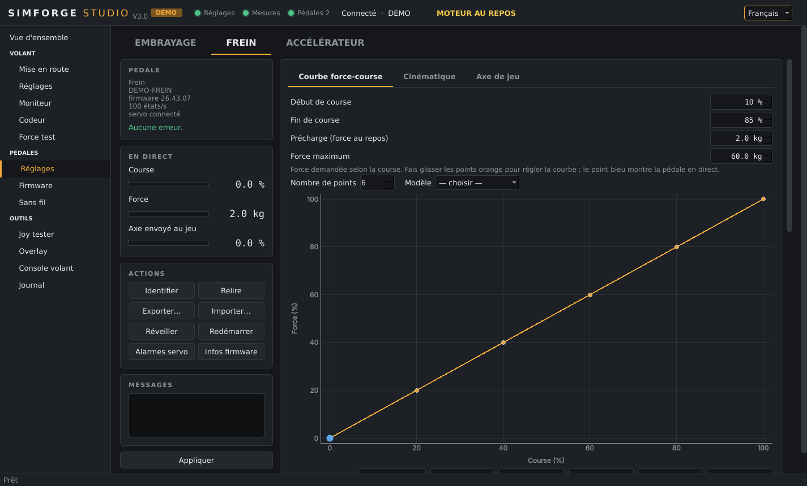
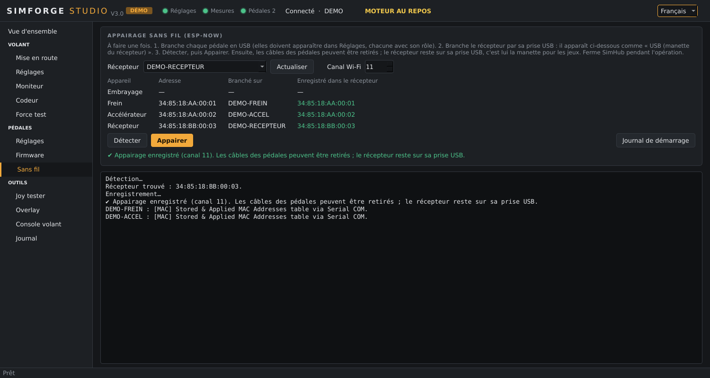
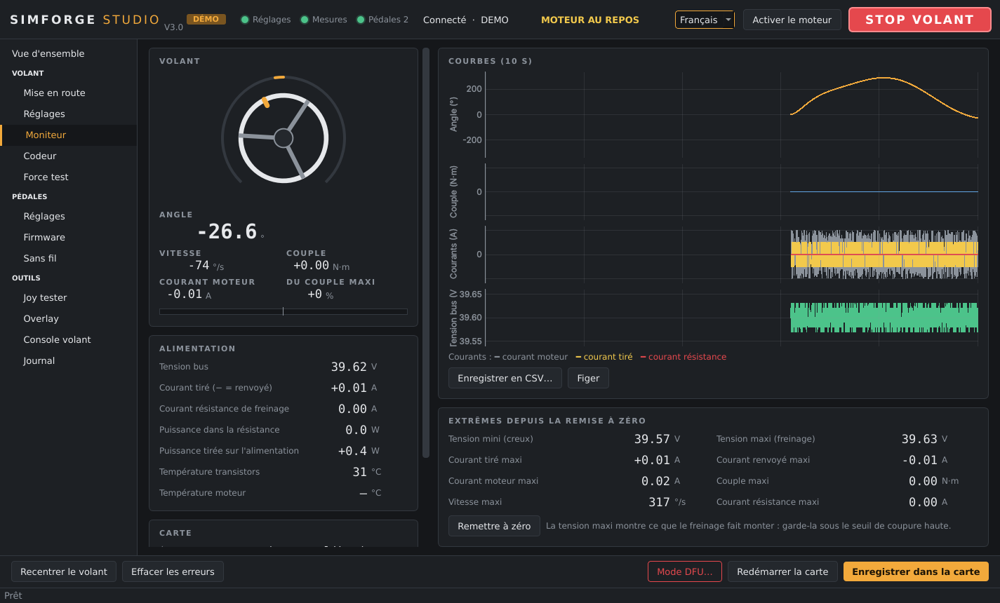
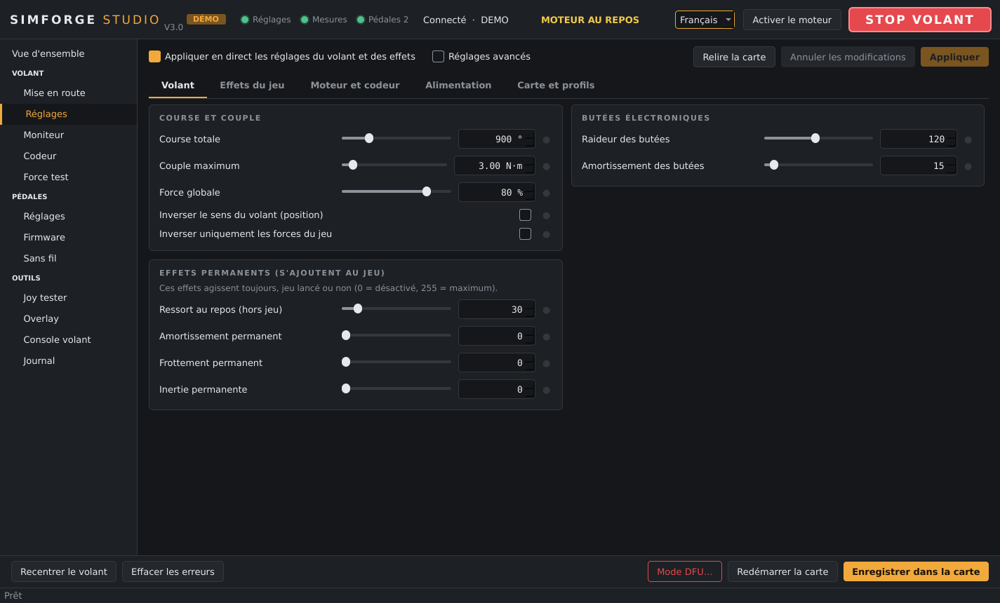
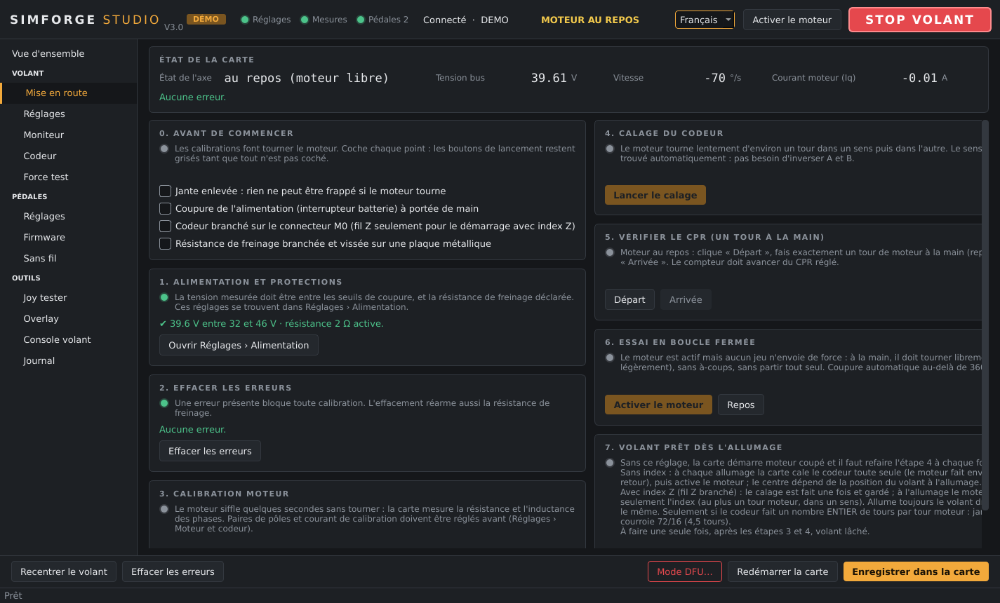

# SimForge Studio

**Un seul logiciel Windows pour régler un volant à entraînement direct et des pédales actives faits maison.**

SimForge Studio pilote un volant sur carte ODrive (firmware Odrive-Wheel) et les pédales actives DIY de ChrGri,
par câble ou sans fil, sans autre logiciel. Interface en anglais ou en français.

## Ce qu'il fait

### Pédales actives

Courbe force-course à dessiner à la souris, schéma de la cinématique, filtres, effets (ABS, régime, patinage),
diagnostic du servo et auto-test qui cherche un réglage sans vibration. Les pédales s'utilisent par câble USB
ou sans fil, et se flashent depuis SimForge.

### Volant

Mise en route guidée d'une carte neuve, tous les réglages au même endroit, courbes en direct et essais des
effets de retour de force sans lancer de jeu.

### Outils

Test des manettes telles que les jeux les voient, overlay affichable par-dessus un jeu, console de la carte
et journal de tout ce qui est envoyé au matériel.

## Matériel pris en charge

| | Matériel |
|---|---|
| Volant | Carte ODrive v3.6 (ou compatible) avec le firmware Odrive-Wheel |
| Pédales | Pédales actives [DIY-Sim-Racing-FFB-Pedal](https://github.com/ChrGri/DIY-Sim-Racing-FFB-Pedal) de ChrGri : carte PCB V6, ESP32-S3, servo iSV57T |
| Sans fil | Un ESP32-S3 DevKitC en plus, branché au PC, qui sert de récepteur |

## Installer

1. Télécharge `SimForge-Studio-Setup-x.y.z.exe` dans les [Releases](https://github.com/Greg7900/SimForge-Studio/releases).
2. Lance-le. Windows affiche « éditeur inconnu » car l'installeur n'est pas signé : clique « Informations
   complémentaires », puis « Exécuter quand même ».
3. Ouvre SimForge Studio depuis le menu Démarrer.

Pour essayer sans matériel, ou lancer SimForge depuis le code, voir [docs/MAINTENANCE.md](docs/MAINTENANCE.md).

## Premiers pas

**Avant tout** : ferme SimHub et l'outil web Odrive-Wheel. Un port série ne s'ouvre que dans un programme à la fois.

**Volant**
1. Branche la carte en USB : le voyant « Réglages » passe au vert.
2. Carte neuve : suis **Volant › Mise en route**, étape par étape.
3. Règle la course, le couple et les butées dans **Volant › Réglages**, puis **Enregistrer dans la carte**.

**Pédales**
1. Flashe chaque pédale dans **Pédales › Firmware**, par la prise UART de son ESP32.
2. Dans **Pédales › Réglages**, donne-lui son rôle (embrayage, frein, accélérateur), règle la course et la force,
   puis **Enregistrer dans la pédale**.
3. Pour le sans-fil : flashe le récepteur, branche-le par sa prise USB, puis **Pédales › Sans fil › Détecter › Appairer**.

Un réglage modifié reste en orange tant qu'il n'est pas envoyé. « Appliquer » l'essaie sans le garder ;
« Enregistrer » le mémorise dans le matériel.

## Licence et crédits

Les firmwares des pédales et du récepteur fournis viennent du projet
[DIY-Sim-Racing-FFB-Pedal](https://github.com/ChrGri/DIY-Sim-Racing-FFB-Pedal) de ChrGri et de ses contributeurs,
sous licence CC BY-NC-SA 4.0 : usage non commercial, mention des auteurs, partage dans les mêmes conditions.
SimForge Studio est un projet personnel, fourni sans garantie. Un volant à entraînement direct peut blesser :
garde toujours la coupure d'alimentation à portée de main.
